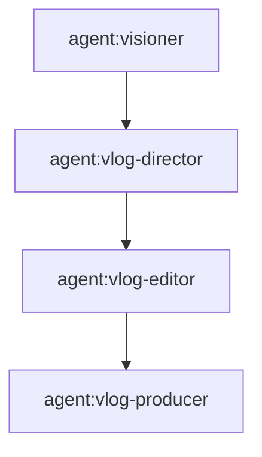

# Neo Project

Create thin Neo projects. The project owns domain intent, Graph, Agent and Artifact contracts. Agents Relay owns Job/Task/Review lifecycle, routing, leases and recovery. Shared Neo skills own reusable capabilities. Never duplicate these runtimes inside a project.

## 1. Standard project structure

```text
<project>/
├── README.md                # human overview, refers to graph.mmd
├── AGENTS.md                # agent/project rules, refers to graph.mmd
├── graph.mmd                # single canonical normal-stage topology
├── agents/                  # project-only *.agent.md, optional
├── contracts/               # reusable JSON Schemas, optional
├── config/                  # reusable non-secret configuration, optional
├── templates/               # reusable project templates, optional
├── neo-project              # optional executable lifecycle entrypoint
├── setup/bootstrap.md       # optional interactive setup agent instructions
└── runs/                    # ignored, private durable execution artifacts
```

Do not create empty directories. Shared Agents, contracts and skills must be referenced, not copied. All actual execution inputs, intermediate files, versions, generated media, reviews, receipts and private state go under `runs/<YYYY-MM-DD[-slug]>/`, or `runs/<series-name>/<YYYY-MM-DD[-slug]>/` for series. Keep secrets and user content out of tracked files. Run-producing work uses the canonical project directory, never a temporary Git worktree. No project may depend on another project's `runs/`.

## 2. Canonical Graph

The sole normal-stage DAG is `<project>/graph.mmd`. README, AGENTS, Planner and examples **refer to that file**; they must not separately maintain stage arrays or copy its edges.

Use the currently supported Relay `parseAgentGraph` subset: one `flowchart TD|TB|LR|RL` header, declarations `node[agent:agent-name]`, edges `node --> node`, and optional `%%` comments. Do not add YAML frontmatter or richer Mermaid labels unless the parser actually supports them.



Graph nodes define normal roles and predecessor relations, not an entire historical Task Tree. Relay's existing `agentGraph` parser executes roles **inside a Task**; it does not automatically create persistent Stage Tasks. A project Planner may map project Graph nodes to durable Stage Tasks where independent artifacts/lifecycle justify it. Do not claim an automatic Graph-to-Plan validator exists, and do not require one: Plans can be partial, incremental and revised.

Keep `parentTaskId` (semantic ownership) separate from `dependencies` (execution order). An Episode can have its own Root Task with Stage children; Visioner is not automatically the Episode Root. A Final Review Task needs no parent and references the Job/immutable reviewed artifact. Troubleshoot/revisions are dynamic Tasks outside the normal Graph. Pin the Graph version/hash in execution context when mid-run edits would change semantics.

## 3. Agent manifest

Create `agents/<name>.agent.md` only for project-specific behavior. Shared Agents are discovered from Neo/global layers. Frontmatter contract:

```yaml
---
name: vlog-producer
description: Produce a video from an approved edit plan
type: worker
inputs:
  - edit-decision-list
outputs:
  - video
  - preview
reviewers:
  - video-director
  - market
---
```

- `name`, `description` identify the Agent; `type` describes `worker`, `planner` or `reviewer`.
- `extends`, `mode`, `sections` may use the current supported inheritance contract.
- Optional `inputs`, `outputs` list artifact contract names. Optional `reviewers` lists specialist Agent names.
- All referenced Agents must be visible in the resolved project/shared catalog. Do not invent names.
- Dependencies belong in Graph; worker/provider/model and retry belong to Relay, not frontmatter.
- The I/O and reviewer fields are **declarative guidance**, not currently automatic Relay validation gates. Do not claim otherwise.

The owning Stage Agent can invoke the existing Relay `review run` Action for specialist reviews, fix the output and request review again before exiting. Specialist reviewers do not automatically become Graph nodes or durable Tasks.

### Human interaction within a Stage

Set human review requirements in the **project Stage contract**, not as
special nodes in `graph.mmd` or an implicit Relay Task. Use `optional` when
the Agent may need facts or creative guidance; use `required` when the
current artifact revision must be approved before Stage completion.

The Stage Agent chooses an available interactive tool based on the artifact:
questions for missing facts, choices for alternatives, and an existing
specialized preview for renderable media. A required video preview currently
needs an interactive ChatGPT Worker and Markcut `video.md`; Planner must
declare the capability requirement for routing. If unavailable, fail/hold
without fabricating approval. Feedback -> fix -> new preview happens inside
the **same Worker** until the current revision is approved. Save feedback and
version-bound approval evidence under `runs/`; downstream QA checks it.
An interactive UI approval is not automatically a Relay Task transition or
permission to publish. This contract does not add a new Relay HITL Action.

## 4. Artifact contract and handoff

Each Agent owns its declared output types. Store reusable schemas in `contracts/<type>.schema.json` (or reference an existing shared schema); define per-run artifact paths under `runs/`. Do not duplicate schema bodies in agent prose.

For structured JSON artifacts:
1. Read the required upstream artifact and its actual version/source evidence.
2. Produce a versioned output with source references/provenance as needed.
3. Explicitly run `npx agents-relay artifact validate --artifact PATH --schema PATH`.
4. Repair invalid output before handoff. Downstream Agents verify required inputs and consume the current accepted version.
5. Keep prior output versions when later revisions could change dependent work.

The Relay Action checks JSON Schema and reports PASS/FAIL without mutating lifecycle state. **No automatic Plan or Task completion gate is added.** Quality, factual provenance and media/non-JSON checks remain project-specific. A schema-valid artifact is not automatically accepted by a Reviewer.

## 7. Revision contract

`graph.mmd` is the normal execution path; the actual Task Tree is expandable historical evidence.

When Final Review returns `CHANGE_REQUIRED`:
1. Reviewer records structured findings against the immutable complete Job result; Reviewer does not edit artifacts.
2. Planner examines findings, Graph dependencies, actual Artifact I/O and versions to identify affected owners and consumers.
3. Create only necessary revision Tasks. Reuse original responsible Agents; never default to an omnipotent revision worker or mechanically rerun every downstream stage.
4. Associate each revision with the original owning Stage Task (normally `parentTaskId`). Record original Task, findings, input/output versions, changed scope and acceptance criteria in durable Task input/result. Do not require unsupported new Task schema fields.
5. Order revisions by actual `dependencies`; revalidate changed outputs and truly invalidated downstream artifacts.
6. Re-review the **complete current Job result**, not merely the modified fragment. Retain previous Tasks, artifacts and reviews unchanged.

Internal Stage Review/Fix via `review run` does not normally create another durable Task. Independent Final Review stays parentless and linked to its Job/version. Relay continues to own all Task lifecycle, recovery and Job completion decisions.

## 9. Project lifecycle contract

Installable/persistent projects expose exactly one optional executable `<project>/neo-project` entrypoint. Neo.app discovers it and calls only commands advertised by its help:

```text
./neo-project setup|start|stop|restart|status|health|uninstall|help
```

- Commands must be idempotent. `setup` prepares dependencies/config without starting work. `start` starts only owned services. `stop` drains/stops. `restart` verifies the replacement.
- `status` emits machine-readable JSON. `health` checks actual dependencies and exits nonzero when unhealthy.
- `uninstall` removes services, never user media, credentials or `runs/`.
- A project or feature may provide a non-empty `setup/bootstrap.md` for interactive installation. Neo.app exposes **Setup with Agent** only when that file exists. `neo project resolve NAME` reports `setup.bootstrap` and `lifecycle.entrypoint` when present; `neo project setup-agent NAME` delegates Chrome launch to the CLI. The button opens a new user Chrome tab at ChatGPT with a short prefilled prompt that names the **absolute bootstrap path** and asks @neo to read it. ChatGPT on its own cannot access the Mac filesystem: the setup agent must use @neo. The user owns the conversation; no Relay Job or Browser Workspace setup session is created.
- The bootstrap coordinates account creation, permissions, ChatGPT Projects/threads, service setup and real first-use verification, with consent gates. It is idempotent, does not contain secrets, and checks existing state before making changes. `./neo-project setup` remains the safe scripted dependency/config preparation step; do not overload it with browser/account setup.
- Pure Agent projects may omit this entrypoint or unsupported commands.
- Reuse PM2/shared Neo service management; never add another scheduler, Task database, MCP server or Neo.app project backend unless a concrete missing capability requires it.

## Creation/refactor workflow and verification

1. Define one repeatable durable outcome and project/shared/Relay ownership.
2. Create the one `graph.mmd` and parse it using the current Relay parser.
3. Update README/AGENTS to reference Graph and describe Task parenting without restating Graph edges.
4. Add only discoverable unique Agent manifests; declare useful I/O and reviewer fields.
5. Add structured Artifact Schemas and per-run handoffs, then test valid/invalid examples with the Relay Action.
6. Simulate one cross-stage finding and confirm the Planner can select minimal revision owners/dependencies without a Graph-to-Plan Validator.
7. Add/test the lifecycle script only for persistent services.
8. Execute one real outcome with fresh evidence, QA and any authorized external receipt before claiming production readiness.
9. Reflect reusable lessons in the project's AGENTS, not in a run diary.

A zero exit code, existing file, rendered media, click or attempted publication is not sufficient evidence of success. Respect explicit approval boundaries for publishing, spending and external commitments.
