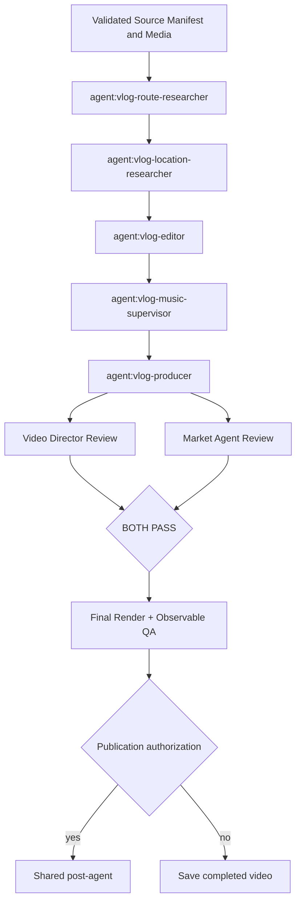
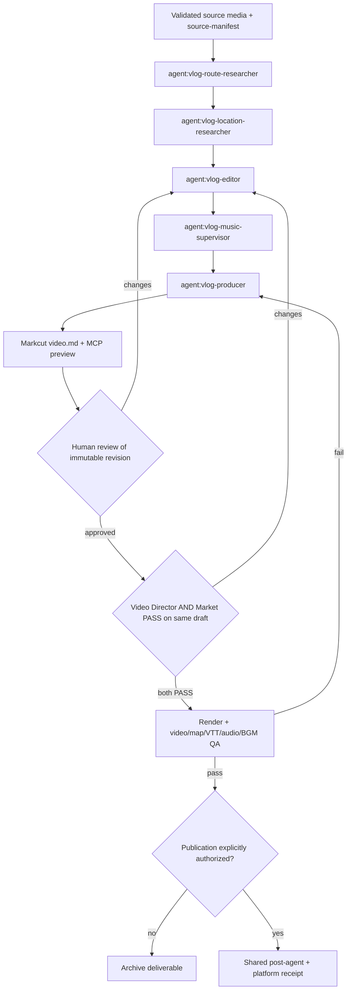

# Vlog Project Rules

Vlog is a thin Neo content project. Root `AGENTS.md` and `MISSION.md` apply first.

All Vlog episodes obey [the stage acceptance contract](docs/episode-stage-contract.md). Do not create an episode Task for a manifest with `INPUT_NEEDED`; source-use approval is mandatory. Archive accepted output by default, publishing only after explicit human authorization. Review corrections are Relay lifecycle work rather than agentGraph cycles.

## Planner topology — primary contract

One top-level Episode Task contains this sequential specialist graph. No extra job or worker scheduler is created by any of these stages.



Run-level graph code: `lib/episode-graph.mjs`; inbox watcher passes it to Relay as `agentGraph`. Specialist outputs are episode artifacts, not separate top-level Tasks. The production/human preview change loop and publication gates are further detailed below.

One episode = **exactly one top-level durable Task**.

Never create sibling top-level Tasks for source collection, media analysis, story, edit planning, production, review, render, QA, or publication of the same episode.

If a phase truly needs an independent durable lifecycle, create a child/descendant Task under the episode Task. Valid reasons include external wait, explicit approval, isolated retry/reconciliation boundary, durable blocker, or independently resumed work.

Use only discoverable agents. Do not invent agent names or hard-code worker/provider/model selection.

## GPS-first enrichment and music — binding episode design

This is **one episode Task with an agentGraph**, not a second scheduler, research Job, or parallel unreviewed publication path. The discoverable specialists are `vlog-route-researcher`, `vlog-location-researcher`, and `vlog-music-supervisor`, followed by the existing `vlog-editor` and `vlog-producer`. The runnable graph is defined in `lib/episode-graph.mjs` and used by the inbox watcher. Each specialist writes evidence into the same run directory; a missing external service is an explicit evidence gap, never fabricated output.



**Route researcher** extracts photo EXIF/video QuickTime capture times, timezone provenance, GPS, stops, segment boundaries, outliers, privacy redaction and inferred movement confidence. It writes `route-evidence.json`; only observed camera/source evidence can support a claim that an activity or travel mode actually occurred. Missing GPS falls back to time-based narrative, not synthetic movement. Do not expose private GPS to public NeoY mounts without explicit permission.

**Location researcher** consumes privacy-safe stops and time windows and looks up geographically/time-matched nearby events, activities, points of interest, landmarks, history, cultural context and *historical weather for the capture date* (not today's forecast). Store `location-enrichment.json`: source URL, fetched/published timestamp, place, time relevance, attribution, confidence and usage permission. Label every suggestion as `observed`, `nearby_at_time`, `historical_context`, or `future_suggestion`; proximity never proves attendance. If only general weather or current information is available, do not assert past conditions. Research may enrich narration/graphics, never overwrite the media's story truth.

**Editor** integrates the route evidence and optional verified enrichment into `story.md` and `visual-brief.md` (hook → discovery/journey → payoff), retaining the original footage, speech, ambient sound and meaningful route/cinematic map transitions. Use source-matched Chinese introductions by default. Keep derived map animations distinguishable from the actual recorded track; no claimed visits or historical facts without provenance.

**Music supervisor** makes BGM **required for every finished episode**. Write `music-plan.json` recording candidate track, owner/license/allowed use, provenance, timing against story beats, beat-aware cuts, gain/fades, dialogue/narration/original-sound ducking and audio verification. Use shared audio sourcing/TTS skills and do not buy tracks, invent rights, or publish copyrighted music without authorization. If no authorized track exists, mark `INPUT_NEEDED` and block final production approval; do not silently omit BGM. Verify non-silent mixed BGM in both actual Markcut MCP player and final rendered video.

**Producer** assembles canonical `video.md` with original imagery/video, native Markcut `map view:route`/`view:cinematic` where supported, licensed BGM, original sound and **WebVTT (`.vtt`) subtitles**, not raw SRT URLs (which Markcut treats as literal text). MCP preview request-changes/approve must apply to a content hash; automated Video Director and Market PASS, final playback QA and distinct publication permission are separate gates. If map tiles/audio cannot actually render in the embedded player, do not certify playback from compilation alone.

Optional Remotion components may be implemented in shared Markcut only, with deterministic playback tests: route transition, cinematic camera/map view, location/event card, historical fact attribution card, weather overlay, lower-thirds, and music ducking. Vlog owns story contracts/templates, **not** a fork of Remotion, a duplicate media renderer, or a second source-of-truth workflow.

Episode evidence flow: `source-manifest.json` → `route-evidence.json` → `location-enrichment.json` → `story.md` / `visual-brief.md` → `music-plan.json` → canonical `video.md` → `reviews/` → `qa.md` → optional `publish/receipt`. Each claim must link to its source and every artifact remains inside the same episode run.

## Ownership

```text
Vlog-specific judgment
  -> vlog-editor / vlog-producer / this contract

Agents Relay lifecycle
  -> Job / Task / graph / retry / routing / events / reconcile

Reusable capability
  -> shared Neo agent/skill
```

Do not build Vlog-local copies of phone-media access, vision, Video Director, Execution Director, image/video generation, audio/TTS, Markcut, Market Agent, post adapters, model router, worker router, or troubleshooting.

## Optional location branch

The episode and its hook/development/payoff exist independently of GPS. Do not create or require a map scene without useful trustworthy metadata, creative relevance and explicit disclosure approval. No GPS means a complete ordinary episode; partial GPS means only verified sample locations, never invented stops or movement. Reject implausible points, ambiguous timestamps and sensitive coordinates. Label calculated road routes as inferred navigation, not recorded tracks. Preserve the canonical one-Task agentGraph, Chinese narration/captions by default, authorized BGM, both required review gates and publication approval.

## Source and story contract

Use only authoritative real media/evidence from the requested source window. Phone media should come through the installed shared phone-media/NeoX capability when needed.

PRs or system logs may support context when the episode is about technical work, but Vlog remains story-first rather than artifact-list-first.

The editor must produce one coherent arc:

```text
real media
   ↓
source-manifest.json
   ↓
HOOK -> MOMENT/TENSION -> DEVELOPMENT -> PAYOFF
   ↓
visual-brief.md
```

Do not widen dates, fabricate activities, or imply that media shows something it does not show.

## Visual-direction contract

`visual-brief.md` is the primary creative asset consumed by Producer and Video Director.

For each beat specify:

- audience intent;
- exact source media/evidence;
- selected shot/image/audio or missing capture requirement;
- crop/composition/visual treatment;
- motion/transition relationship;
- text/graphic/chart/diagram needs when they add meaning;
- original sound / narration / BGM / SFX intent.

Video Director turns the creative intent into canonical `video.md`. Execution Director compiles unresolved media requirements when needed. Runtime agents materialize assets; Markcut renders.

## Production quality

- Prefer real footage and useful original sound.
- Narration is optional. If used, it must use the user's approved voice identity unless an explicit fallback is authorized.
- BGM is mandatory for finished episodes; source it through the shared audio-sourcing capability and mix/duck it around dialogue, narration, and meaningful original sound. SFX remain deliberate editorial choices.
- Use strong composition, meaningful cuts, motion, transitions, effects, and pacing.
- Use charts, diagrams, generated explanatory images, screenshots, or kinetic typography only when they improve comprehension without pretending to be real source evidence.
- Render vertical short-form video unless the Task specifies another format.
- Verify the observable final video, including picture, sound, pacing, and source truth.

## Mandatory pre-render gate

Final render is forbidden until both required reviews pass:

```text
Production Draft
      │
      ├────────────► Video Director Review
      │                  │
      │            PASS / CHANGE_REQUIRED
      │
      └────────────► Market Agent Review
                         │
                   PASS / CHANGE_REQUIRED

PASS + PASS -> Final Render
```

Video Director reviews hook, story-to-scene translation, shot selection, pacing, visual grammar, cuts/transitions/effects, and sound design.

Market Agent reviews audience clarity, hook/cover strength, emotional or curiosity pull, platform fit, and whether the episode works for someone without internal context.

Persist review evidence under `reviews/`. Required changes must be incorporated and re-reviewed.

## Run contract

```text
runs/<YYYY-MM-DD[-slug]>/
├── source-manifest.json
├── route-evidence.json
├── location-enrichment.json
├── story.md
├── post.md
├── visual-brief.md
├── music-plan.json
├── video.md
├── execution/
├── assets/
├── reviews/
│   ├── video-director.md
│   └── market.md
├── output/
├── qa.md
└── publish/
```

A genuine named series may use `runs/<series-name>/<YYYY-MM-DD[-slug]>/`. Do not create generic wrappers such as `runs/neo-vlog/` or `runs/daily-vlog/`.

All per-run artifacts belong in the run root. `runs/` is ignored by Git.

## Publication

Publication target/authorization comes from the active Job/Task. Use shared `post-agent`, verify platform-side state, and persist the receipt/status. A successful click or adapter exit code is not publication proof.

## Project learnings

- 2026-09-26: Vlog previously duplicated Agents Relay with local jobs, routing, autopilot, personas, style, and templates. Keep the project thin.
- 2026-09-27: Follow the shared `neo-project` contract: chart-first human/planner docs, one top-level Task per episode, discoverable project agents, shared capabilities, explicit run handoffs, and observable acceptance gates.
- 2026-10-04: Route/movement evidence, mandatory BGM, spoken Hey Neo edit commands, lively motion/CG treatment, and Simplified Chinese defaults are enforceable production/review contracts rather than optional style suggestions.
- 2026-10-21: Route/location research is optional work owned by `vlog-editor` with shared capabilities, not missing specialist graph nodes. Synthetic review fixtures must materialize every dependency and immutable r1/r2 revision, including per-beat sound/motion/transition evidence; hash real bytes, reject changed/stale dependencies, and never treat simulation, parser validation, or authorization booleans as QA or publication eligibility.


## Route Story, language, movement, and command contract

When source photos or videos contain usable GPS/location metadata, location and movement are first-class story evidence rather than decorative metadata.

- Extract available GPS/location metadata and capture timestamps.
- Group media into supported stops and route segments without fabricating missing coordinates.
- Recognize movement mode from combined evidence, distinguishing at minimum walking/strolling, cycling, driving, and unknown.
- Do not infer movement from GPS speed alone when visual/audio evidence contradicts it. Use road/trail context, camera motion/height, vehicle/bicycle/interior evidence, time displacement, and clear source audio.
- Record confidence/evidence and prefer unknown over invention.
- Use route and movement mode to shape narration, pacing, transitions, and scene interpretation.
- Default generated titles, route narration, captions, chapter labels, and voiceover scripts to Simplified Chinese unless the user explicitly requests another language.
- Route Story narrative order is: where we went -> how we moved -> what happened there.
- Open with route/movement context when it helps the story; major location or movement changes may use short route transitions; end with a route recap when useful.
- If only some media has GPS, associate no-GPS media with a stop only when timestamp/context evidence supports it. With no usable GPS, use the normal non-route flow.

When source video contains speech, transcribe enough audio to detect explicit editing commands.

- Hey Neo is the default wake phrase; equivalent configured wake phrases may also be supported.
- Treat the utterance immediately after a wake phrase as an editing-instruction candidate, not ordinary story dialogue.
- Persist source clip/time range, recognized command, confidence/ambiguity, and resulting edit intent/action in run evidence.
- Apply clear supported instructions such as keep/remove/emphasize/reorder a shot, preserve original sound, add text/narration, change pacing, or choose a transition.
- Do not invent missing arguments for ambiguous commands.
- Normally exclude the wake phrase and command from final story audio unless the user clearly intends them to remain.

## Default visual-energy contract

- For ordinary personal/travel Vlogs, default to a joyful, light, lively, energetic tone unless the real source story clearly calls for another mood.
- Avoid a static slideshow feel. Use purposeful composition, cuts, motion, transitions, effects, tempo changes, and music-synchronized editing.
- Add meaningful motion graphics / CG / effects when they improve storytelling: dynamic route drawing, movement-mode graphics, kinetic typography, parallax/photo motion, speed ramps, freeze frames, playful graphic accents, or explanatory CG.
- CG/generated/effect material must remain clearly editorial/explanatory and must never masquerade as real source footage.

## Expanded review requirements

Video Director review must explicitly verify:

- hook, story-to-scene translation, and shot selection;
- lively pacing and avoidance of stiff/static slideshow treatment;
- purposeful cuts, transitions, motion graphics, CG/effects, and music-synchronized rhythm;
- mandatory BGM plus intelligible mix/ducking around dialogue, narration, and meaningful original sound;
- Optional map/movement-mode treatment only when reliable location evidence and disclosure approval exist; no-GPS episodes need no maps;
- compliance with recognized Hey Neo edit commands and correct treatment of command audio;
- source truth and clear separation of generated visuals from real footage.

Market Agent review must explicitly verify:

- audience clarity and hook/cover strength;
- emotional energy appropriate to the story, defaulting to joyful/light/lively for ordinary personal/travel Vlogs;
- curiosity/entertainment pull and platform fit;
- whether the episode feels engaging and dynamic rather than stiff, repetitive, or visually flat;
- whether route/movement context helps the viewer understand the journey when applicable.

Final QA must include observable BGM/mix, visual energy, effects, route/movement treatment when applicable, spoken-command compliance, and source truth.
