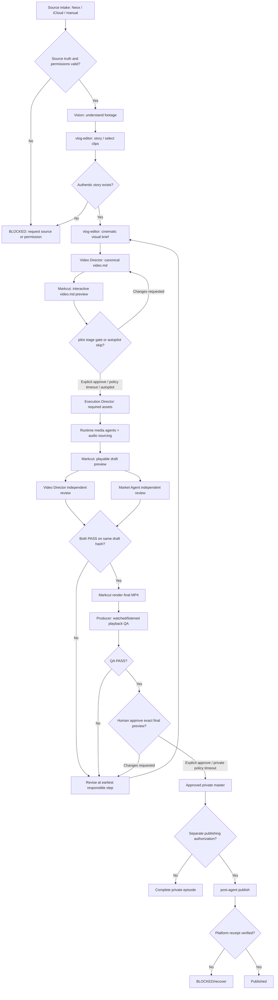

# Cinematic Vlog production template

This is a reusable, tracked **template**, not a run. All actual episode material and evidence stays in ignored `vlog/runs/YYYY-MM-DD[-slug]/`. Keep **one top-level durable episode Task**; stages are steps in its agentGraph and do not automatically require separate Tasks. Existing `../cinematic-episode.md` defines source schemas and quantitative QA.

**Single source of cinematic editorial truth:** `video.md` is the primary input/output across user discussions, edits, preview, review, revision, and rendering. Never create a competing canonical timeline or treat `story.md` / `visual-brief.md` as the main user interface. Those are background planning inputs and traceable evidence. Every user comment should resolve to specific scene IDs or timecodes and produce a diff in `video.md`, followed by fresh Markcut preview.

The selectable user interaction modes and timeout decision semantics are defined in [INTERACTION.md](INTERACTION.md).

## Executable design graph

## Agent, input, output and gate contracts

All paths below are relative to each episode run folder.

| Step | Owner / agent | Input | Output | Review / rejection |
|---|---|---|---|---|
| Intake | Neox phone media / iCloud watcher / manual | authorized originals, requested date window | `source-manifest.json`, `input/` | Reject missing hash, permission, source, or invalid time window |
| Understanding | shared vision | original media + manifest | `analysis/observations.md` with clip IDs and timecodes | Distinguish observation from assumptions |
| Story | `vlog-editor` | source + observations + intent | `story.md` | Real hook, conflict/discovery and payoff or INSUFFICIENT_SOURCE |
| Direction | `vlog-editor` | story and selected clips | `visual-brief.md` | Shot scale, composition, motion, continuity, color, pacing, real audio and BGM per beat |
| Interactive creative discussion and approval | user via Markcut preview | **`video.md`** as the primary editable/reviewable artifact, playable draft, optional story/brief/source evidence | updated **`video.md`**, `reviews/creative-approval.json` binding exact `video.md` SHA-256, actor, time and feedback | Discuss and iterate on video.md; changes_requested -> Video Director, no reply -> supported timed policy continuation; never claim a human click |
| Shot authoring | shared Video Director | story + visual brief | `video.md` | Canonical Markcut source; explicit placeholders for missing assets |
| Asset compilation | shared Execution Director | `video.md` markers | `execution/` typed requests | No invented footage or unsupported tool assumption |
| Asset sourcing | reusable media runtime, audio-sourcing | source + requests + license rules | `assets/` and provenance/license records | Reject unauthorized media/music; original footage has priority |
| Timeline and audio mix | `vlog-producer` via shared Markcut/audio-sourcing | `video.md`, clip timecodes, licensed tracks, original sound | `execution/timeline-audio.md` with shot in/out, frame rate, musical beats, cut motivation, gain/ducking targets | Reconcile duration/beat grid; unsupported effect -> explicit dependency or safe cut |
| Draft | Markcut player | `video.md` + resolved assets | preview + `reviews/draft.json` hash | Must be visibly playable before reviews |
| Film review | Video Director review | preview + draft hash + creative brief | `reviews/video-director.md` | PASS / CHANGE_REQUIRED, timecoded changes |
| Audience review | Market Agent review | same preview + hash | `reviews/market.md` | Independent PASS / CHANGE_REQUIRED |
| Final render | Markcut | both PASS reports on identical draft | `output/final.mp4` | Never render final on divergent reviews |
| Playback QA | producer/media QA | actual MP4, provenance, score rubric | `qa.md`, final hash, video/audio measures, observed playback notes | >=85/100, each category >=70%, no critical issue; otherwise revise |
| Human approval | user via preview UI | playable final video, QA, review outcomes | `reviews/human-approval.json` | Explicit approved / changes_requested, actor, timestamp, exact file hash |
| Publication (optional) | shared post-agent | approved master + **separate** platform-specific publishing authorization | `publish/receipt.json` | Verify platform-side receipt; otherwise blocked |

## Durable node and failure-path rules

The **definitions** (this graph, `../cinematic-episode.md`, `RESEARCH.md`) are versioned in `vlog/templates/cinematic-vlog/`; the table's **outputs** are private, ignored `vlog/runs/YYYY-MM-DD[-slug]/` artifacts. Use only discoverable `vlog-editor` and `vlog-producer` from `vlog/agents/`, `vision-understanding`, `market`, `post-agent` from `agents/`, shared Video Director and Execution Director skills, and the Markcut capability. Capability/skill roles are not invented Relay agents. The producer owns the render, playback QA and feedback routing.

Every node must persist either the listed output or a typed failure/blocked reason in `execution/stage-status.json` (stage, status, owner, artifact paths, input SHA-256, reason, timestamp); Relay remains the authoritative lifecycle source. Intake/review source hashes always point to bytes actually examined. For changes to source identity return to Intake; clip interpretation to Understanding; narrative to Story; composition/style to Direction; unsupported effect to Shot authoring; music rights to Asset sourcing; timing/mix to Timeline; visual/audio defect to Draft/Render. Re-review **both** independent reviewers after any draft change. A blocker is not a PASS.

The central user-facing artifact is **`video.md`**: Video Director creates it early, Markcut preview plays it, and the user discusses scene-specific changes against that same document. `story.md`, `visual-brief.md`, manifests, and analysis are supporting context rather than separate user approval targets. The creative checkpoint occurs **after an initial playable video.md preview**; its decision is recorded in `reviews/creative-approval.json`. The final checkpoint shows the **actual playable MP4** (fullscreen when supported), `qa.md`, both review reports, `visual-brief.md`, and final hash; its decision is recorded in `reviews/human-approval.json`. Actual user Approve/Request changes is recorded distinctly from configured policy timeout. A timeout can move on with private work only; it is never called a human approval. Approval records include actor, time, approved content hashes, decision and feedback; never fabricate responses.

## Required review and approval rules

- A changed `video.md` or draft hash invalidates both automated review PASS decisions. Revisions rerun both reviews and actual playback QA.
- In `pilot`, present the Markcut `video.md` preview for creative-direction approval or policy timeout before committing to final asset production. In `autopilot`, skip the intermediate human gate. The assistant must iterate on the same `video.md` after feedback and re-present the updated preview; approval of a draft is not approval of the eventual final MP4.
- AI reviewers cannot grant human approval. Human approval covers one immutable final MP4 hash; changed output requires renewed QA and approval.
- Show the actual playable video (fullscreen if supported), `visual-brief.md`, director and Market review findings, and QA evidence before requesting approval.
- Approval is **not authorization to publish**. Post-agent may run only with an explicit separate publication decision; a missing response is neither approval nor publishing authorization.
- Keep Graph/task lifecycle with Agents Relay, and rendering with Markcut. Do not introduce a local orchestration engine or duplicate renderer.

## Open-source study

See [RESEARCH.md](RESEARCH.md) for verified repository ownership, license boundaries, reusable direction/shot/audio contracts, deliberate non-adoptions, and validation gaps.
