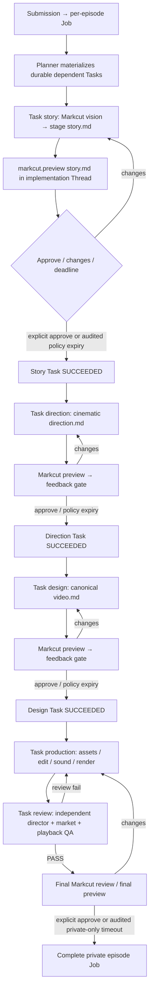
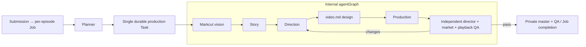

# Per-submission Job planning: pilot versus auto

The **submission** is a Job boundary. Inbox watcher validates/de-duplicates each authentic submission and requests one Relay Job for that submission, with `mode=pilot|auto`, source-manifest reference, authorizations and target Thread metadata. Do not attach unrelated submissions to an indefinitely running template-development Job. This document is the proposed contract for a new intake-to-Job bridge; the deployed watcher currently creates Tasks on a preconfigured Job and **does not yet implement this bridge**.

## `pilot` — Thread-only, one user review gate per dependent Task

The Planner creates Task dependency edges (story → direction → design → production → final review); the Graph is not just a picture. Each Task is assigned an eligible ChatGPT Thread worker (or uses supported implementation-task thread delivery), has exactly one principal Markcut-supported Markdown output, and **remains unresolved until user feedback is handled and the approval/timeout decision has been durably recorded**. Task output includes artifact path, SHA-256, preview receipt, decision actor and feedback record. `markcut.preview({path})` is the generic MCP Markdown approve/request-changes surface; `markcut preview <file> --storyboard` is the separate video storyboard player. Use the relevant surface rather than claiming they are identical.

`story` calls `markcut vision <input/media>` first and validates generated `metadata.json` against real assets; then constructs an evidence-grounded storyboard/story Markdown. The Story Task must not succeed before actual preview approve, a valid recorded private-policy deadline, or an explicit blocked/failure result. Changes requests loop *within the same Task*, not a fresh Job. The dependency enforces that the next stage starts only after predecessor success. A no-interaction timeout must use a verified existing durable continuation facility; writing a deadline alone does not fire a wakeup. If the worker cannot resume at that time, leave a truthful waiting/blocked state rather than mark Task succeeded.

## `auto` — one production Task with internal agentGraph

Auto persists exactly the same `story.md`, `direction.md`, `video.md`, reviews, provenance and private output, but no intermediate user-facing waits. It can run in Codex/CLI/background environments. A final preview can be offered when a user-facing channel actually exists; lack of such channel must not block a private master. No mode confers permission to publish or perform other external actions.

## Job metadata and stage result contract

- `requested_mode=pilot` requires a confirmed bidirectional ChatGPT Thread capable of calling Markcut's MCP preview tool. A Thread ID alone is insufficient. Otherwise use `auto` before planning, with persisted `effective_mode` and fallback reason.
- Each stage has `input` (prior stage artifact+hash, source manifest, creative constraints), `owner agent`, `output` (stage `.md`/assets), `approve gate`, `deadline policy` and `failure/revision edges`. Example: `story`: vision input files + intent → `vision/metadata.json`, `previews/story.md` → preview review receipt → gate resolution → dependent `direction`.
- Persist approve/timeout and delivery evidence under private `runs/<episode>/reviews/` with `artifact_path`, `sha256`, `thread_id`, `decision_actor`, `delivered_at`, `deadline_at`, `decided_at`, and `feedback`; never mislabel policy expiry as human approval.
- Planner-created Tasks must be durable and graph-authoritative. Implementation and reviewer thread IDs are destinations only for eligible roles, not generic APIs for submitting previews to arbitrary threads. Adapt agent selection/routing through supported Relay capabilities; do **not** add Vlog-specific Relay server logic.
- Final PASS requires real source provenance, both independent director and market review on the exact draft, playback QA, and final gate resolution. Approval never authorizes publishing.

## Implementation prerequisites / honest status

1. Deployed iCloud watcher is currently Task-on-existing-Job, **not** one-Job-per-submission. Implement/change the intake adapter in Neo Vlog, keeping idempotence and atomic submission ownership; no Relay core patches for Vlog.
2. Validate Planner produces the intended dependency edges and each interactive stage can actually route to a Thread/Markcut MCP preview (the current `implementationThreadId` routes only recognized implementation Tasks).
3. Test same-Task feedback iteration, approval durability and a short real deadline/continuation. Never assume an ordinary single ChatGPT turn can wait 60 minutes or re-awaken itself.
4. Only after those pass can `pilot` be declared end-to-end operational. Current active pilot is an older single `vlog-editor → vlog-producer` Task and is **not** proof of the multi-Task design.
